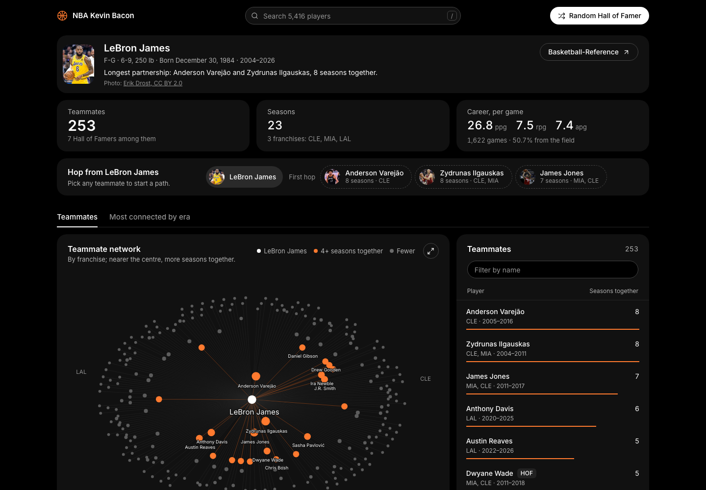
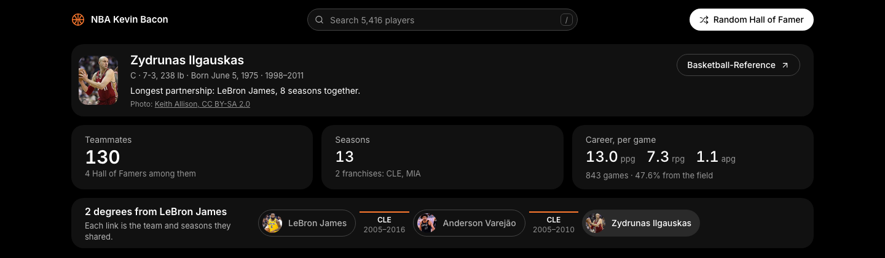
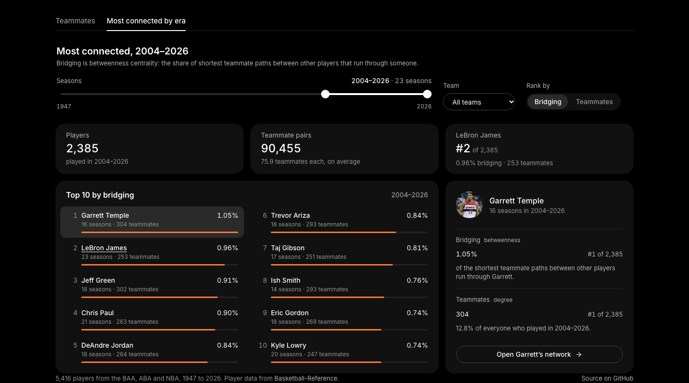
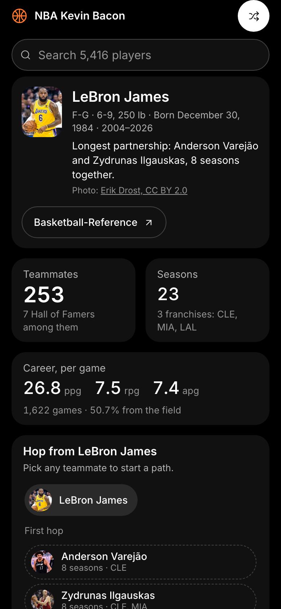

# The NBA's Kevin Bacon

This is a pet project for me. I wanted more experience with applications of graph theory, so I built a map
of every NBA player and their teammates: 5,416 players from the BAA, ABA and NBA, 1947 through the 2025-26
season.



## What you can do

- **See anyone's teammates.** Search a player, or jump to a random Hall of Famer. The network groups their
  teammates by franchise, and the nearer a teammate sits to the centre, the more seasons they shared. The
  list beside it ranks them, and the season chart shows when they overlapped.
- **Play the Kevin Bacon game.** Click any teammate to hop to their network. The hop path keeps score: each
  link names the team and seasons two players shared, and it counts the degrees from where you started.

  

- **Find who tied an era together.** The second tab ranks every player in a range of seasons, by teammates
  (degree centrality) or by bridging (betweenness centrality: the share of shortest teammate paths between
  other players that run through them). Narrow it to one franchise, and see where the current player ranks.

  

- **Use it on a phone.** Every view folds down to one column.

  

Career numbers and photos load with the player. Photos are linked from Wikimedia Commons (never copied into
this repo) and credited on the player's page.

## Running it

Needs Node 24 (`nvm install && nvm use` reads `.nvmrc`). Yarn 4 is pinned in `package.json` and runs through
corepack, so there is nothing else to install.

```sh
make install   # install dependencies
make dev       # app at http://localhost:3000, plus the API on :3001
make check     # lint (Oxlint), type-check (TypeScript 7) and unit tests (Vitest)
make storybook # component explorer at http://localhost:6007
make data      # rebuild players, stats and photo links
```

Run `make` on its own to list every target.

## How it's built

- **App:** React 19 on Vite, drawn with vis-network and lucide icons. The player data ships with the app, so
  searching and hopping need no server.
- **API:** a small Express server (`server/`) answers the era questions. It indexes every team season by year
  and team, with its teammate pairs worked out up front, so finding the k team seasons in a range takes
  O(log n + k) and the graph is assembled from their pairs. It scores the graph on worker threads: degree
  centrality, and betweenness centrality by Brandes' algorithm, with the sources split across the workers.
- **Data:** `make data` runs `scripts/build-player-data.ts`, which reads Basketball-Reference's season
  rosters and box scores (from a pinned snapshot) and finds photos through Wikidata and Wikimedia Commons.
- **Stories:** the main components have Storybook stories, played in headless Chromium with accessibility
  checks (`make test-stories`). They load a 674-player slice of the data that `make data` also writes, so
  they stay quick.

## API

```
GET /api/network?startYear=1980&endYear=2000&team=BOS&sort=degree&limit=25&focus=birdla01
GET /api/teams?startYear=1980&endYear=2000
```

Years are seasons' end years (2026 is 2025-26) and every parameter is optional. `sort` is `betweenness`
(the default) or `degree`, and `focus` adds one player's scores and ranks to the response. Scoring all 80
seasons at once takes a few seconds; a decade or two takes well under one, and repeat requests come from a
cache.

## How to contribute

You can get an idea of what features and extensions I'm looking to make on this project in
[TODO.md](TODO.md). Fork this repo and make a PR, or just make an issue.
