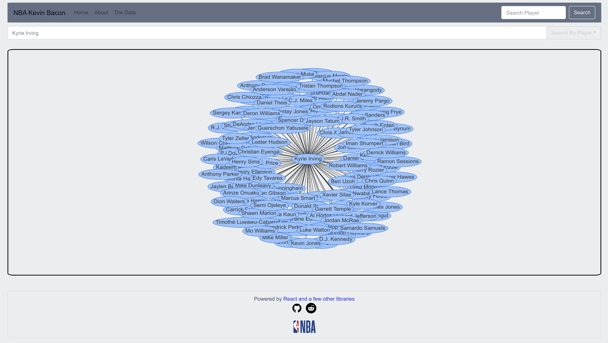

# The NBA's Kevin Bacon

This is a pet project for me.

I'm building a graphical representation of NBA players and their teammates because I wanted to get some more
 experience with applications of graph theory.
 
 
 
 ## Running it
 Needs Node 24 (`nvm install && nvm use` reads `.nvmrc`). Yarn 4 is pinned in `package.json` and runs through
 corepack, so there is nothing else to install.

 ```sh
 make install   # install dependencies
 make dev       # app at http://localhost:3000, plus the API on :3001
 make check     # lint, type-check and test
 make storybook # component explorer at http://localhost:6007
 make data      # rebuild players and stats (Basketball-Reference) and photo links (Wikimedia Commons)
 ```

 Run `make` on its own to list every target.

 ## API
 The app asks a small Express server (`server/`) who the most connected players of an era are. It indexes
 every team season by year and team, with its teammate pairs worked out up front, so finding the k team
 seasons in a range takes O(log n + k) and the graph is assembled from their pairs. It scores the graph on
 worker threads: degree centrality, and betweenness centrality by Brandes' algorithm.

 ```
 GET /api/network?startYear=1980&endYear=2000&team=BOS&sort=degree&limit=25
 GET /api/teams?startYear=1980&endYear=2000
 ```

 Years are seasons' end years (2026 is 2025-26) and every parameter is optional. Scoring all 80 seasons at
 once takes a few seconds; a decade or two takes well under one, and repeat requests come from a cache.

 ## How to contribute
 You can get an idea of what features and extensions I'm looking to make on this project by going to the [/TODO.md
 ](/TODO.md) directory.
  Fork this repo and make a PR, or just make an issue.
